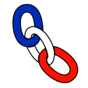

#  Keðjan - Interactive sentence builder for Icelandic
Keðjan ‘the chain’ is an interactive sentence builder for learners of Icelandic. Users can create a sentence by choosing on their own a subject, a verb and an object and can edit the sentence by adding or removing a definite article, an adjective, an auxiliary or modal verb, and also by changing the subject, verb and object. Users can see how any change impacts the sentence at every turn. The purpose of this webapp is to help students to understand and gain more insight into how the Icelandic sentence structure functions.

<i>Credits (icons): <a href="https://www.flaticon.com/authors/magnific">Magnific</a>, <a href="https://www.flaticon.com/authors/mihimihi">Mihimihi</a>, <a href="https://www.flaticon.com/authors/nhor-phai">Nhor Phai</a>,<a href="https://www.flaticon.com/authors/nikita-golubev">Nikita Golubev</a>, <a href="https://www.flaticon.com/authors/three-musketeers">Three musketeers</a>, <a href="https://www.flaticon.com/authors/vitaly-gorbachev">Vitaly Gorbachev</a>, <a href="https://www.flaticon.com/authors/icon-home">Icon home</a>, <a href="https://www.flaticon.com/authors/berkahicon">berkahicon</a>, <a href="https://www.flaticon.com/authors/afitrose">afitrose</a>, <a href="https://www.flaticon.com/authors/amonrat-rungreangfangsai">amonrat rungreangfangsai</a>, <a href="https://www.flaticon.com/authors/karyative">Karyative</a>, <a href="https://www.flaticon.com/authors/good-ware">Good Ware</a>, <a href="https://www.flaticon.com/authors/kalashnyk">Kalashnyk</a>, <a href="https://www.flaticon.com/authors/bert-flint">Bert Flint</a>, <a href="https://www.flaticon.com/authors/POD-gladiator">POD Gladiator</a>, <a href="https://www.flaticon.com/authors/iconjam">Iconjam</a>, <a href="https://www.flaticon.com/authors/Anditii-Creative">Anditii Creative</a>, <a href="https://www.flaticon.com/authors/YesternightSupply">YesternightSupply</a>, <a href="https://www.flaticon.com/authors/smashingstocks">smashingstocks</a>, <a href="https://www.flaticon.com/authors/mangsaabguru">mangsaabguru</a>, <a href="https://www.flaticon.com/authors/graphicmall">graphicmall</a>, <a href="https://www.flaticon.com/authors/smalllikeart">smalllikeart</a> <a href="https://www.flaticon.com/authors/khld939">khld939</a>, <a href="https://www.flaticon.com/authors/cube29">cube29</a>, <a href="https://www.flaticon.com/authors/LAFS">LAFS</a>, <a href="https://www.flaticon.com/authors/Dewi-Sari">Dewi Sari</a>, <a href="https://www.flaticon.com/authors/Umeicon">Umeicon</a>, , .</i>

